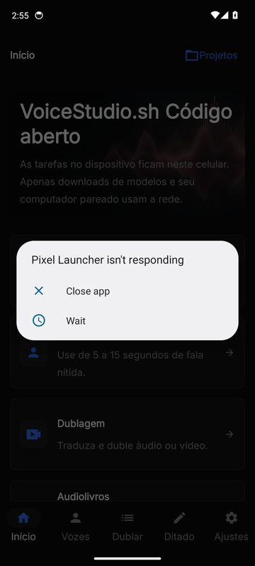
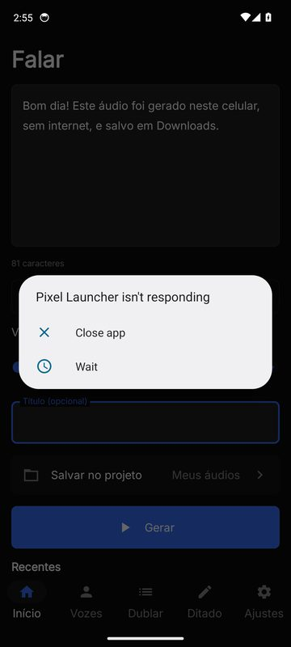
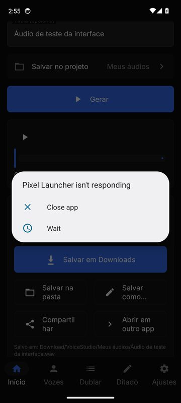
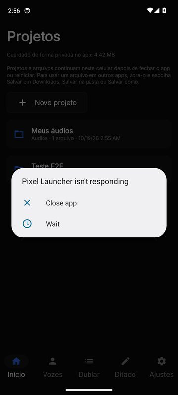

# VoiceStudio VozIA para Android

Versão Android do [VoiceStudio](https://github.com/debpalash/VoiceStudio) (AGPL-3.0) que roda **no
próprio celular**: texto em fala com IA (incluindo português), clonagem de voz, ditado, transcrição de
áudio/vídeo com legendas, audiolivros por capítulos e dublagem — tudo offline depois de baixar os modelos,
com projetos persistentes e exportação para Downloads ou qualquer pasta.

Baseado no código Android do próprio VoiceStudio (branch `feat/mobile-on-device`), completado com
motores em português, biblioteca de projetos, armazenamento persistente, tarefas em segundo plano,
audiolivros, transcrição de arquivos e testes em emulador. Veja a
[análise do projeto original](docs/ANALISE-DO-PROJETO.md).

## Baixar e instalar

1. Abra as [Releases](https://github.com/Fakesss/VozIAApk/releases) e pegue a build mais recente
   (`build-N`). Para a maioria dos celulares use **`VoiceStudio-VozIA-N-arm64-v8a-debug.apk`**
   (ou `-universal-` se não souber a arquitetura).
2. No celular, permita "Instalar apps desconhecidos" para o navegador/gerenciador de arquivos e abra o APK.
3. Requisitos: **Android 10 ou superior**, processador **64 bits** (ARM64 ou x86_64), 3 GB de RAM
   (6–8 GB para clonagem e dublagem), 500 MB livres para começar.

O app usa o identificador `io.github.fakesss.vozia` e convive com o VoiceStudio oficial.

## Primeiro uso (teste rápido)

1. **Início → Falar**: digite um texto. Se o celular tiver um mecanismo de voz offline (por exemplo,
   o do Google), a **voz do sistema Android** já funciona, sem download.
2. Para a voz de IA em português, toque no seletor de modelo e escolha **Piper Faber (português do
   Brasil)** (67 MB, sugerido primeiro em celulares em português) ou **Supertonic 3** (129 MB,
   31 idiomas); toque em **Baixar**, revise e aceite a licença.
3. Toque em **Gerar**. A geração roda em segundo plano (pode sair da tela) e aparece em **Tarefas**.
4. Ouça no player e toque em **Salvar em Downloads**. O app mostra o local exato, por exemplo
   `Download/VoiceStudio/Meus áudios/Bom dia.wav`, e **Abrir em outro app**.
5. Feche o app, reinicie o celular e abra de novo: o áudio continua em **Projetos** e em **Recentes**.

Capturas reais do app em um emulador Android 14 durante os testes automatizados.

## Se uma tarefa parecer parada

* Em **Tarefas**, cada tarefa mostra a etapa, a porcentagem e há quanto tempo está rodando. "Aguardando
  outra tarefa liberar o modelo" significa que ela está na fila atrás de outra (por exemplo, uma
  dublagem); vozes comuns (Piper, Supertonic, Kokoro, voz do sistema) não esperam mais por clonagens ou
  dublagens.
* Vozes clonadas e dublagem usam o modelo grande OmniVoice: contam segundos a minutos por frase no
  celular. O progresso avança a cada passo; dá para cancelar a qualquer momento.
* Se o Android estiver limitando a bateria do app, tarefas longas podem pausar com a tela desligada.
  Em **Ajustes → Desempenho e segundo plano**, toque em **Permitir em segundo plano**.
* Para pedir ajuda, use **Ajustes → Copiar relatório de diagnóstico** (aparelho, aceleração do
  processador, modelos e últimas tarefas; sem textos nem áudios).

## Recursos

| Recurso | Estado | Onde |
|---|---|---|
| Texto em fala (voz do sistema, Piper pt-BR, Supertonic 3, Kokoro v1.0/v1.1, Kitten) | ✅ no celular, offline | Falar |
| Velocidade, vozes nomeadas, idioma, título, projeto de destino | ✅ | Falar |
| Clonagem de voz por gravação ou arquivo (OmniVoice) | ✅ no celular (validado em emulador com 8 GB; lento, exige 6 GB RAM) | Vozes |
| Criar, renomear, excluir vozes | ✅ | Vozes |
| Gravação e importação de áudio | ✅ | Vozes, Transcrever |
| Transcrição de áudio/vídeo → TXT, SRT, VTT (Whisper) | ✅ no celular | Transcrever |
| Ditado: inglês em tempo real (Zipformer) e português/outros por frases (Whisper) | ✅ no celular | Ditar |
| Audiolivros: TXT/MD/EPUB, capítulos editáveis, geração em segundo plano, livro completo | ✅ | Audiolivros |
| Dublagem de vídeo (Whisper → Qwen3 → OmniVoice, sincronização por segmentos, MP4/WAV) | ✅ no celular (validado em emulador com 8 GB; lento, ~2 GB de modelos) | Dublar |
| Projetos persistentes, histórico de tarefas, exclusão com confirmação | ✅ | Projetos, Tarefas |
| Exportar WAV/M4A para Downloads, pasta escolhida ou "Salvar como", compartilhar, abrir em outro app | ✅ | Todos os resultados |
| Gerenciar modelos (baixar, cancelar, retomar, excluir, licenças) | ✅ | Configurações → Modelos |
| Usar um VoiceStudio desktop pareado para motores pesados (opcional) | ✅ herdado do upstream | Configurações → Conectar |
| Separação de vocais (Demucs), diarização de locutores | ❌ não portado (PyTorch desktop) | — |
| Motores CosyVoice, IndexTTS, VoxCPM2, MOSS, dots.tts, Confucius4 no celular | ❌ só via computador pareado | — |
| Design de voz por descrição, API local/MCP, pastas monitoradas | ❌ não portado | — |

Detalhes de modelos, velocidade e licenças: [docs/MODELOS.md](docs/MODELOS.md).

## Armazenamento

Projetos, áudios, transcrições, vozes, modelos e histórico ficam no armazenamento privado do app e
**sobrevivem a fechar o app, reiniciar e atualizar**. Para usar um arquivo fora do app, exporte-o; o
app confere a cópia por SHA-256 e nunca sobrescreve arquivos existentes.
Detalhes: [docs/ARMAZENAMENTO.md](docs/ARMAZENAMENTO.md).

## Privacidade

* Todo o processamento no celular é local. Nenhuma gravação, texto ou voz é enviado a serviços externos.
* A internet é usada somente para baixar modelos quando você toca em **Baixar** (GitHub/Hugging Face) e,
  se você parear, para falar com o seu próprio computador.
* Sem contas, sem anúncios, sem relatórios de falha; backup em nuvem desativado.
* Clone apenas vozes que você tem permissão de usar. Os áudios gerados recebem um marcador de áudio
  sintético nos metadados.

## Compilar

Veja [docs/COMPILACAO.md](docs/COMPILACAO.md) (local e GitHub Actions, APK/AAB assinados).

## Testes

155 testes JVM e testes de ponta a ponta em emuladores Android 10, 14 e 15 (celular e tablet):
download do modelo, geração real de fala em português, exportação para Downloads, leitura por outro
app, persistência após fechar, reiniciar e atualizar, falta de espaço, cancelamento, além de clonagem
e dublagem com modelos grandes. Nenhum celular físico foi testado ainda.
Relatório completo: [docs/RELATORIO-DE-TESTES.md](docs/RELATORIO-DE-TESTES.md).

## Licença e créditos

* Código: **GNU AGPL-3.0** ([LICENSE](LICENSE)), como o VoiceStudio original.
  Copyright © 2024-presente Palash Debnath e colaboradores do VoiceStudio; modificações deste fork ©
  2026 colaboradores do VozIAApk. Veja [NOTICE.md](NOTICE.md) e [LICENSE-NOTICE.md](LICENSE-NOTICE.md).
* Bibliotecas nativas: sherpa-onnx, ONNX Runtime, eSpeak NG, OmniVoice.cpp, llama.cpp e outras — avisos
  completos em Configurações → Licenças e em `mobile/android/app/src/main/assets/licenses/`.
* Pesos de modelos **não** são cobertos pela AGPL: cada um tem sua própria licença, exibida e aceita no
  app antes do download.
* "VoiceStudio" é o nome do projeto original; este é um fork não oficial.
